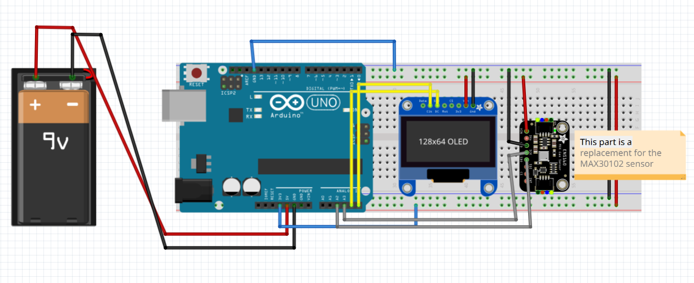

# heart_sensor_BMI

 An Arduino Uno prototype that reads heart rate with a **MAX30102**
 optical (PPG) sensor, shows live **BPM** on a **0.96" SSD1306 OLED**,
 and blinks an LED on every beat — plus a student lab guide for
 investigating how optical heart-rate sensing works.


<p align="center">
  
</p>

---

## Table of contents

- [Overview](#overview)
- [Features](#features)
- [How it works](#how-it-works)
- [Hardware](#hardware)
- [Wiring](#wiring)
- [Repository structure](#repository-structure)
- [Getting started](#getting-started)
- [Using the monitor](#using-the-monitor)
- [Student investigation](#student-investigation)
- [Roadmap: BMI](#roadmap-bmi)
- [Troubleshooting](#troubleshooting)
- [License](#license)
- [Author](#author)

---

## Overview

`heart_sensor_BMI` is an Electrical & Computer Engineering independent project I carried out to understand the generic heart sensors.
A **MAX30102** module shines red and infrared light into a fingertip and
measures how much light comes back. Because arterial blood volume pulses with
every heartbeat, that reflected light pulses too — a technique called
**photoplethysmography (PPG)**, the same principle behind hospital finger
clips. The Arduino timestamps each pulse, converts the intervals into beats
per minute, and shows the result on a small OLED while an LED flashes in
time with your pulse.

The repository contains the **firmware**, the **wiring documentation**, the
**Fritzing reference files**, and a full **student investigation guide**
(`docs/investigation.md`) that turns the build into a lab exercise covering
PPG theory, experimental method, and error analysis.

> **Not a medical device.** The readings are for education only and must not
> be used for clinical decisions.

## Features

-  **PPG heart-rate sensing** with the MAX30102 over I2C (address `0x57`).
-  **SSD1306 128×64 OLED** output: large BPM value, status prompts, and a
  heartbeat glyph.
-  **Beat-synchronised LED** on D9 through a 220 Ω current-limiting resistor.
-  **Finger detection** — the display asks for a fingertip when the sensor
  sees only ambient light.
-  **8-beat moving average** for a stable BPM with ~1 beat of lag.
-  **Serial Plotter output** (`IR=... BPM=...`) for viewing the raw PPG
  signal on your PC.
-  **Student lab guide** with background theory, timed experiments,
  observation tables, analysis questions and troubleshooting.

## How it works

```
fingertip ──► MAX30102 red/IR LEDs + photodiode
                  │  (400 samples/s of IR intensity)
                  ▼
            checkForBeat()  ──► inter-beat interval
                  ▼
            BPM = 60 000 / interval  ──► 8-beat average
                  ├──────────► SSD1306 OLED (I2C 0x3C)
                  ├──────────► LED on D9 (one flash per beat)
                  └──────────► Serial @ 115200 for the Serial Plotter
```

Both I2C devices share the Uno's hardware bus — **A4 = SDA, A5 = SCL** — and
coexist because their addresses differ (`0x57` sensor, `0x3C` display).

## Hardware

| Qty | Component                                   | Fritzing search term        |
| :-: | ------------------------------------------- | --------------------------- |
|  1  | Arduino Uno R3                              | `Arduino Uno R3`            |
|  1  | MAX30102 heart-rate sensor                  | `MAX30102`                  |
|  1  | OLED display, I2C, 0.96-inch                | `SSD1306 OLED I2C`          |
|  1  | LED                                         | `LED`                       |
|  1  | 220 Ω resistor                              | `220 ohm resistor`          |
|  1  | Breadboard                                  | `Breadboard`                |
|  —  | Jumper wires (as needed)                    | `Jumper Wire`               |
|  1  | USB cable or suitable power supply          | Appropriate USB/power component |

## Wiring

| Signal                          | Arduino pin | Peripheral    |
| ------------------------------- | :---------: | ------------- |
| MAX30102 `VIN`                  | **3.3V**    | MAX30102      |
| MAX30102 `GND`                  | **GND**     | MAX30102      |
| I2C SDA (sensor + OLED)         | **A4**      | MAX30102, OLED|
| I2C SCL (sensor + OLED)         | **A5**      | MAX30102, OLED|
| OLED `VCC`                      | **3.3V***   | SSD1306 OLED  |
| OLED `GND`                      | **GND**     | SSD1306 OLED  |
| MAX30102 `INT`                  | *(unused)*  | MAX30102      |
| LED (via 220 Ω)                 | **D9**      | LED anode     |
| LED cathode                     | **GND**     | LED           |

\* Power the OLED from the voltage your specific module supports; many
0.96" SSD1306 breakouts accept 3.3–5 V.

See **[`docs/wiring.md`](docs/wiring.md)** for the full pin map, I2C bus
diagram, power budget and assembly checklist, and
[`hardware/`](hardware/) for the Fritzing source
([`basic-heart-rate-sensor-pcb.fzz`](hardware/basic-heart-rate-sensor-pcb.fzz)),
views and a setup video.


## Getting started

### Prerequisites

- [Arduino IDE](https://www.arduino.cc/en/software) 1.8.x or 2.x
- Arduino Uno board package (`Tools → Board → Arduino AVR Boards → Arduino Uno`)

### Install the libraries

In the Arduino IDE: **Tools → Manage Libraries…** and install:

| Library                   | Author                 | Used for            |
| ------------------------- | ---------------------- | ------------------- |
| **SparkFun MAX3010x Sensor** | SparkFun Electronics | MAX30102 driver + beat detection |
| **Adafruit SSD1306**      | Adafruit               | OLED driver         |
| **Adafruit GFX Library**  | Adafruit               | Graphics primitives (installed as a dependency) |

### Wire the circuit

Follow the [Wiring](#wiring) table above or [`docs/wiring.md`](docs/wiring.md).
Use [`hardware/poi.png`](hardware/poi.png) and
[`hardware/SetupVideo.mov`](hardware/SetupVideo.mov) as visual references.
The Fritzing part for the sensor is
[`hardware/gy-max30102-module.fzpz`](hardware/gy-max30102-module.fzpz) —
double-click it to add the MAX30102 to your own Fritzing sketches.

### Build and upload

1. Open `firmware/heart_sensor_BMI/heart_sensor_BMI.ino`.
2. Select **Tools → Board → Arduino Uno** and the correct **Port**.
3. Click **Upload**.
4. Open the **Serial Monitor** at **115200 baud**.

## Using the monitor

1. Power the board over USB.
2. Wait for the OLED to show `Warming up MAX30102...`.
3. Rest a fingertip **gently and still** over the sensor's two optical
   windows — the OLED switches from `Measuring...` to a large BPM value.
4. The LED on D9 flashes once per heartbeat; you can cross-check it against
   the BPM number by counting flashes for 15 s and multiplying by 4.
5. Remove your finger and the reading resets to zero after 2 seconds.

Tips for a clean signal:

- Rest your hand on the table; motion is the number-one source of error.
- Don't press hard — excessive pressure blanches the capillaries.
- Shield the sensor from direct sunlight or lamps if readings wander.

## Student investigation

The heart of this repository as a teaching artifact is
**[`docs/investigation.md`](docs/investigation.md)**. It contains:

1. **Background** — the physics of PPG, why red vs. infrared LEDs matter,
   and the signal chain from photons to BPM.
2. **Procedure** — four timed parts: bus verification, resting heart rate,
   post-exercise recovery, and deliberate signal-quality sabotage.
3. **Observation tables** — ready-to-fill grids for every experiment.
4. **Analysis questions** — including an SpO₂ extension and a BMI extension
   (see below).
5. **Troubleshooting** — symptom → cause → fix table.

Suggested workflow for students: build from [`docs/wiring.md`](docs/wiring.md),
verify with Part A of the investigation, then complete Parts B–D and write up
the analysis questions as a lab report.

## Roadmap: BMI

The repository is named `heart_sensor_BMI`, but the current bill of materials
contains **no weight or height sensor**, so BMI (body mass index,
kg / m²) is not computed yet. Planned extension:

- [ ] Add an **HX711 + load cell** weight sensor and fold it into the BOM.
- [ ] Accept height (cm) and weight (kg) over the Serial Monitor.
- [ ] Compute and display **BMI** alongside BPM on the OLED.
- [ ] Discuss BMI's clinical limitations (it ignores muscle mass, frame size
      and fat distribution) in the investigation guide — question 7 already
      prompts students to design this extension.

Until then, treat BMI as a design exercise rather than a delivered feature.

## Troubleshooting

| Symptom | Fix |
| ------- | --- |
| `SSD1306 not found` in serial | Check SDA/SCL aren't swapped; confirm VCC and GND; scan I2C for `0x3C` |
| `MAX30102 not found` in serial | Confirm `VIN = 3.3V`; scan I2C for `0x57`; check SDA/SCL |
| OLED works, BPM stays 0 | Place and hold a fingertip over the sensor; wait a few seconds |
| BPM jumps around | Keep the hand still; shield from ambient light; average more beats |
| LED never blinks | LED is probably reversed — anode must face the resistor |
| Both I2C devices fail | One may be holding the bus low; unplug one and rescan |

## License

Released under the **MIT License**. See [`LICENSE`](LICENSE) for details.

## Author

**Gift Sato Kuepouo** — A Electrical & Computer Engineering project.
